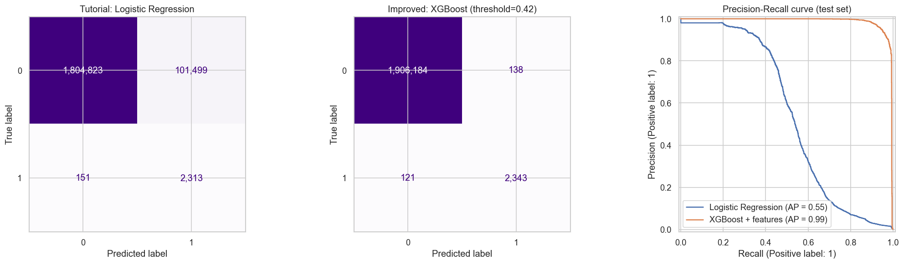
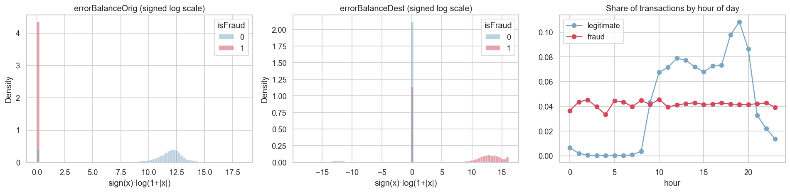
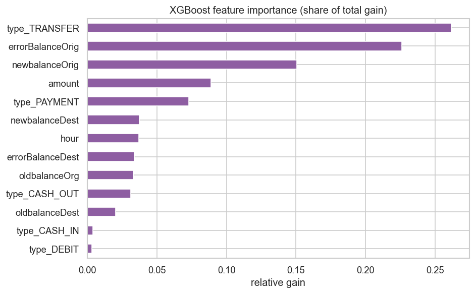

# 🛡️ Fraud Detection in Mobile-Money Transactions

A machine-learning project that detects fraudulent financial transactions among **6.3 million** mobile-money
transfers, served through an interactive **Streamlit** web app.

The project started from a YouTube tutorial and was then **extended and improved**: domain-driven feature
engineering, a gradient-boosted model, validation-based threshold tuning and a time-based robustness check
raised the **fraud precision from 0.02 to 0.94** while also slightly increasing recall.



---

## 📌 Results at a glance

Evaluated on the **same held-out test set** as the tutorial (30%, stratified, `random_state=42`; 1.9M transactions, 2,464 frauds):

| Metric (fraud class)                       | Tutorial baseline<br>Logistic Regression | **This project**<br>XGBoost + engineered features |
| ------------------------------------------ | ---------------------------------------: | ------------------------------------------------: |
| Precision                                  |                                    0.022 |                                         **0.944** |
| Recall                                     |                                    0.939 |                                         **0.951** |
| F1-score                                   |                                    0.044 |                                         **0.948** |
| PR-AUC (average precision)                 |                                     0.55 |                                          **0.99** |
| False alarms (legitimate flagged as fraud) |                                  101,499 |                                           **138** |
| Frauds missed                              |                                      151 |                                           **121** |
| Accuracy                                   |                                    94.7% |                                            99.99% |

👉 Same (actually better) fraud-catching power with **~735× fewer false alarms**.

> **Why not just accuracy?** Only 0.13% of transactions are fraud, so a model that never predicts fraud is already
> 99.87% "accurate". This project therefore focuses on **precision, recall, F1 and PR-AUC** of the fraud class.

### Is the model overfitting?

No harmful overfitting was found. The same model scores almost identically on validation and test data it has never seen:

| Data       | Precision |    Recall |        F1 |    PR-AUC |
| ---------- | --------: | --------: | --------: | --------: |
| Train      |     0.982 |     0.989 |     0.986 |     0.998 |
| Validation |     0.946 |     0.950 |     0.948 |     0.984 |
| **Test**   | **0.944** | **0.951** | **0.948** | **0.987** |

- The small train–test gap (~4 F1 points) is normal for gradient-boosted trees.
- **5-fold cross-validation:** F1 = 0.950 ± 0.004, so the scores are stable across different splits.
- **Time-based split** (train on the past, test on the future): precision 0.985, recall 0.941.

The very high scores mainly come from the dataset being **synthetic** (see [Limitations](#️-limitations--next-steps)), not from overfitting.

---

## ❓ Why does this matter?

- **Financial loss:** card and payment fraud costs banks, fintechs and customers billions every year. Every missed fraud is money lost.
- **Alert fatigue:** a model with low precision (like the baseline: ~44 false alarms per real fraud) floods
  investigators with alerts, blocks honest customers' payments and is ignored in practice.
- **Real-time decisions:** payment systems must decide in milliseconds whether to approve, block or review a transaction —
  exactly what a trained pipeline + a simple app/API provides.
- **Typical ML challenges in one project:** extreme class imbalance, choosing the right metric, feature engineering from
  domain knowledge, threshold selection and avoiding data leakage.

---

## 📊 Dataset

|           |                                                                                                                                                                                                                                                                                    |
| --------- | ---------------------------------------------------------------------------------------------------------------------------------------------------------------------------------------------------------------------------------------------------------------------------------- |
| Source    | Kaggle: [Fraud Detection Dataset](https://www.kaggle.com/datasets/amanalisiddiqui/fraud-detection-dataset) (file `AIML Dataset.csv`)                                                                                                                                               |
| Origin    | Synthetic mobile-money transactions generated by the **PaySim** simulator, based on real logs from a mobile-money service in an African country. The data has the same structure and size as the original [PaySim Kaggle dataset](https://www.kaggle.com/datasets/ealaxi/paysim1). |
| Size      | 6,362,620 transactions × 11 columns (~490 MB)                                                                                                                                                                                                                                      |
| Target    | `isFraud` — 8,213 frauds (**0.13%**)                                                                                                                                                                                                                                               |
| Time span | 743 steps (1 step = 1 hour ≈ 31 days)                                                                                                                                                                                                                                              |

| Column                              | Description                                                       |
| ----------------------------------- | ----------------------------------------------------------------- |
| `step`                              | Hour since the start of the simulation                            |
| `type`                              | `CASH_IN`, `CASH_OUT`, `DEBIT`, `PAYMENT`, `TRANSFER`             |
| `amount`                            | Transaction amount                                                |
| `nameOrig` / `nameDest`             | Sender / receiver ID (not used as features)                       |
| `oldbalanceOrg` / `newbalanceOrig`  | Sender balance before / after                                     |
| `oldbalanceDest` / `newbalanceDest` | Receiver balance before / after                                   |
| `isFraud`                           | **Target** — 1 if the transaction is fraudulent                   |
| `isFlaggedFraud`                    | Flag of the existing rule-based system (not used — only 16 flags) |

> ⚠️ The dataset is too large for GitHub (> 100 MB) and is **not included**. Download it and place it at
> `data/AIML Dataset.csv` (see [Getting started](#-getting-started)).

---

## 🧰 Tech stack

| Area              | Tools                                                                                      |
| ----------------- | ------------------------------------------------------------------------------------------ |
| Language          | Python 3.11                                                                                |
| Data analysis     | pandas, NumPy                                                                              |
| Visualization     | Matplotlib, Seaborn                                                                        |
| Machine learning  | scikit-learn (`Pipeline`, `ColumnTransformer`, `LogisticRegression`, metrics), **XGBoost** |
| Model persistence | joblib                                                                                     |
| Web app           | **Streamlit**                                                                              |
| Environment       | Jupyter Notebook                                                                           |

---

## 🗺️ What I did — step by step

### Part 1 · Tutorial (baseline) → [`notebooks/01_eda_and_baseline.ipynb`](notebooks/01_eda_and_baseline.ipynb)

1. **Data inspection** — shape, dtypes, missing values (none), class balance (0.13% fraud).
2. **Exploratory data analysis** — transaction types, fraud rate per type, amount distribution (log scale),
   balance changes, fraud over time, top senders/receivers, correlation heatmap.
3. **Key finding:** fraud only happens in `TRANSFER` and `CASH_OUT`, typically emptying the sender's account.
4. **Baseline model** — `StandardScaler` + `OneHotEncoder` + `LogisticRegression(class_weight="balanced")` in an sklearn `Pipeline`.
5. **Result** — recall 0.94 but precision 0.02 (≈101k false alarms).
6. **Streamlit app** to make predictions from user input.

### Part 2 · My improvements → [`notebooks/02_improved_model.ipynb`](notebooks/02_improved_model.ipynb)

| #   | Improvement                                                             | Why                                                                                                      |
| --- | ----------------------------------------------------------------------- | -------------------------------------------------------------------------------------------------------- |
| 1   | **Memory-efficient loading** (selected columns, `category` dtype)       | 1.5 GB → 0.3 GB in RAM                                                                                   |
| 2   | **Domain analysis** of balances                                         | Showed that 97.8% of frauds move the sender's _entire_ balance (0.0% of legitimate TRANSFER/CASH_OUT do) |
| 3   | **Feature engineering**: `errorBalanceOrig`, `errorBalanceDest`, `hour` | Capture ledger inconsistencies and time-of-day behaviour (the tutorial dropped `step`)                   |
| 4   | **Train / validation / test split**                                     | Threshold is chosen on validation data, test set stays untouched; test split identical to the tutorial   |
| 5   | **XGBoost** inside the same sklearn `Pipeline`                          | Learns non-linear rules & feature interactions; fast with `tree_method="hist"`                           |
| 6   | **Threshold tuning**                                                    | Highest threshold that keeps recall ≥ 95% → best precision without missing more fraud than the baseline  |
| 7   | **Fair comparison**                                                     | Baseline retrained & evaluated on the exact same test set; confusion matrices + PR curves                |
| 8   | **Explainability**                                                      | Feature importance (gain)                                                                                |
| 9   | **Time-based validation**                                               | Train on the first 80% of the timeline, test on the future → precision 0.985 / recall 0.941              |
| 10  | **Overfitting check**                                                   | Train vs. validation vs. test scores + 5-fold cross-validation                                           |
| 11  | **Refactoring**                                                         | Shared code in `src/`, reproducible training script, model + threshold saved together                    |
| 12  | **Improved app**                                                        | Shows fraud probability, uses the tuned threshold, adds hour-of-day input                                |

### Feature engineering

```text
errorBalanceOrig = newbalanceOrig + amount - oldbalanceOrg   # 0 when sender's books add up
errorBalanceDest = oldbalanceDest + amount - newbalanceDest   # 0 when receiver's books add up
hour             = step % 24                                  # hour of day
```



Legitimate traffic almost disappears between midnight and 8 AM, while fraud stays flat — a transaction at 4 AM is far more suspicious.

### Feature importance



---

## 📁 Project structure

```text
fraud-detection/
├── app.py                          # Streamlit web app
├── data/
│   └── AIML Dataset.csv            # dataset (not in repo, download separately)
├── images/                         # charts used in this README
├── models/
│   ├── fraud_detection_pipeline.pkl  # improved model + decision threshold (used by the app)
│   ├── baseline_logreg_pipeline.pkl  # original tutorial model
│   └── metrics.json                  # test-set metrics of the improved model
├── notebooks/
│   ├── 01_eda_and_baseline.ipynb   # tutorial: EDA + Logistic Regression
│   └── 02_improved_model.ipynb     # my improvements, step by step
├── src/
│   ├── features.py                 # data loading, feature engineering, model pipeline
│   └── train.py                    # reproducible training script
├── requirements.txt
└── README.md
```

---

## 🚀 Getting started

**1. Clone and install**

```bash
git clone https://github.com/beyzanurcaglar/fraud-detection.git
cd fraud-detection
python -m venv .venv
source .venv/bin/activate        # Windows: .venv\Scripts\activate
pip install -r requirements.txt
```

**2. Get the data** — download the [Fraud Detection Dataset](https://www.kaggle.com/datasets/amanalisiddiqui/fraud-detection-dataset) from Kaggle and save it as `data/AIML Dataset.csv`.

**3. Run the app** (a trained model is already included in `models/`)

```bash
streamlit run app.py
```

Try a typical fraud pattern: `TRANSFER`, amount `181`, sender balance `181 → 0`, receiver balance `0 → 0`.

**4. (Optional) Retrain the model** — takes ~30 seconds on a laptop

```bash
python -m src.train
```

or open the notebooks with `jupyter notebook notebooks/`.

---

## ⚠️ Limitations & next steps

- **Synthetic data:** PaySim is simulated. Its balance columns follow simple rules, which makes the
  balance-error features unusually strong; real-world data is noisier and results would be lower.
- **Balance columns:** the dataset description notes that fraudulent transactions are annulled in the simulation,
  so their balance columns do not reflect real outcomes. Both the tutorial and this project use these columns,
  so part of the performance may come from this simulation artifact rather than from patterns that would exist in real data.
- **Concept drift:** fraud patterns change over time; a production system would need monitoring and periodic retraining.
- **Possible next steps:** SHAP explanations per prediction, hyperparameter search with cross-validation,
  cost-based threshold (cost of a missed fraud vs. a false alarm), a REST API (FastAPI) and Docker deployment.

---

## 🙏 Acknowledgements & references

- **Tutorial this project is based on:** Onur Baltacı — [_Fraud Detection Using Machine Learning – Full Python Data Science Project_](https://youtu.be/4Od5_z28iIE) (YouTube).
  Notebook 01 and the original app follow this tutorial; everything in notebook 02, `src/` and the updated app are my own extensions.
- **Dataset:** [Fraud Detection Dataset](https://www.kaggle.com/datasets/amanalisiddiqui/fraud-detection-dataset) (Kaggle), generated with the PaySim simulator — E. A. Lopez-Rojas, A. Elmir, S. Axelsson, _PaySim: A financial mobile money simulator for fraud detection_, EMSS 2016.
- [scikit-learn](https://scikit-learn.org/) · [XGBoost](https://xgboost.readthedocs.io/) · [Streamlit](https://streamlit.io/)
